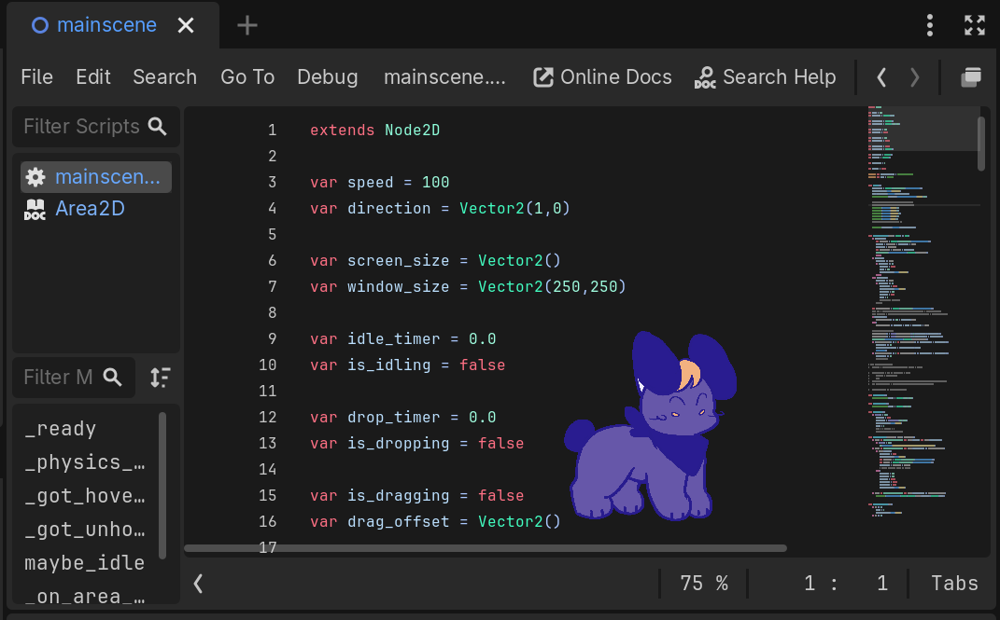
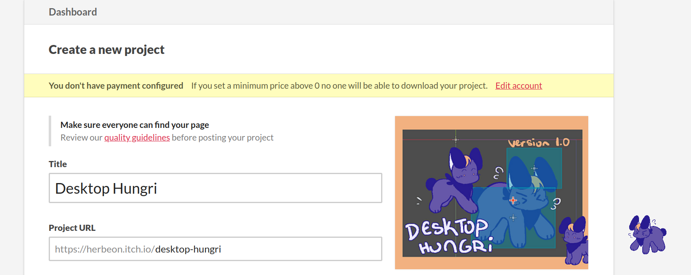
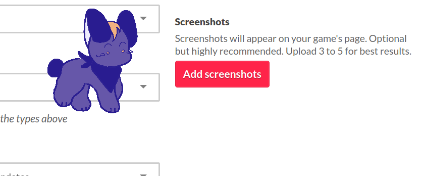

# desktop hungri
the hungri ([as seen in cori's call](https://github.com/Herbeon/coriscall)) becomes a desktop pet. made for [Hack club playground!](https://playground.hackclub.com/)

# screenshots

# how to install
[download at the itch.io link.](https://herbeon.itch.io/desktop-hungri) available for linux and windows!

# tools used
* made with godot
* art drawn in krita by me!
* the version that I'm shipping to playground took around 5 hours
* 100% human-made, no ai was used

# features
* walks horizontally (the hungri is canonically immune to the effects of gravity.)
* can get dragged around (it tries to escape.) (it cannot escape.)
* occasionally idles
* right click for menu: can turn smol, flip around, and defy gravity!
* a secret, if you double click enough...

# will add...
* a hover feature (when my collision starts working qwq)
* sits down and watches your screen (a friend showed me other desktop pets that do this and I thought it was very cute.)
* random hunger (for memory/tabs when I figure that out)
* yeeeeeeeet
* interacting with Hungri (desktop vn?! /jk)
* feeding the hungri
* more animations!! falling, zooming, sleeping...

# things I learned
This is my second shipped godot project! (my first one was during polaris) I learned a bunch more about gdscript (it's actually quite like python!) and explored more of godot yay. 

please let me know if there are any bugs. (I know they're a bit finicky when you drag them to edges)

